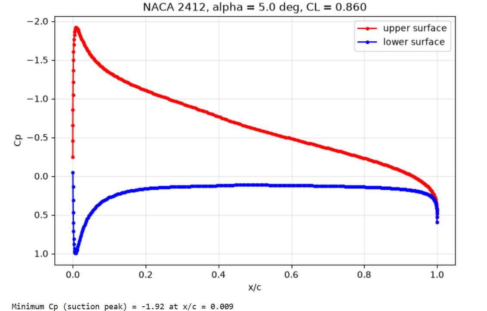
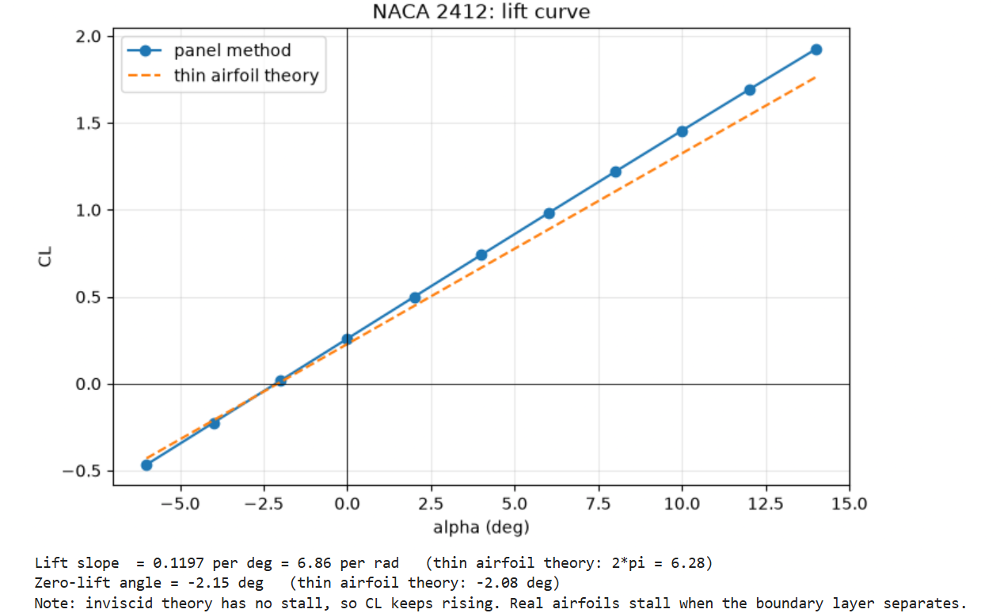
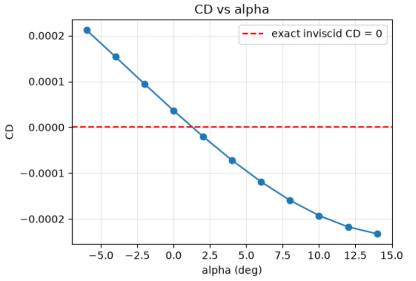
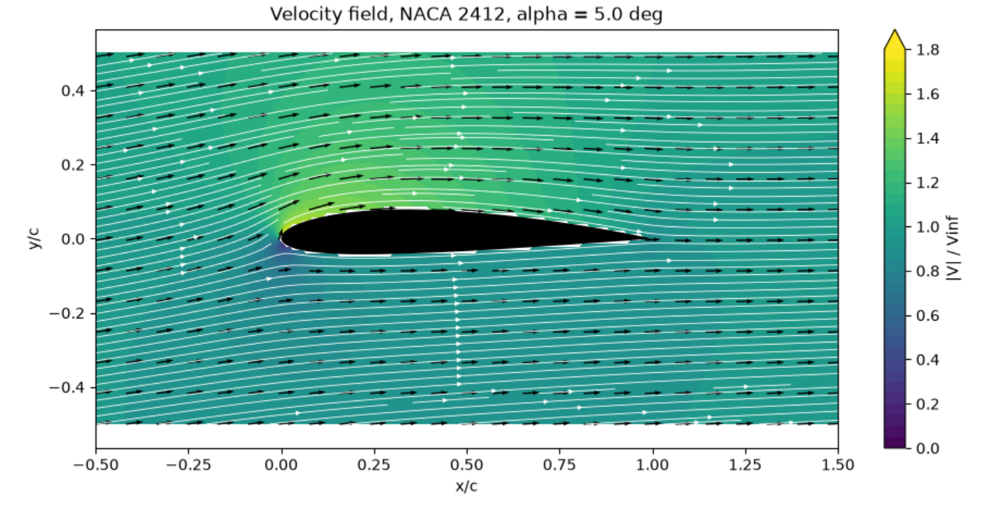
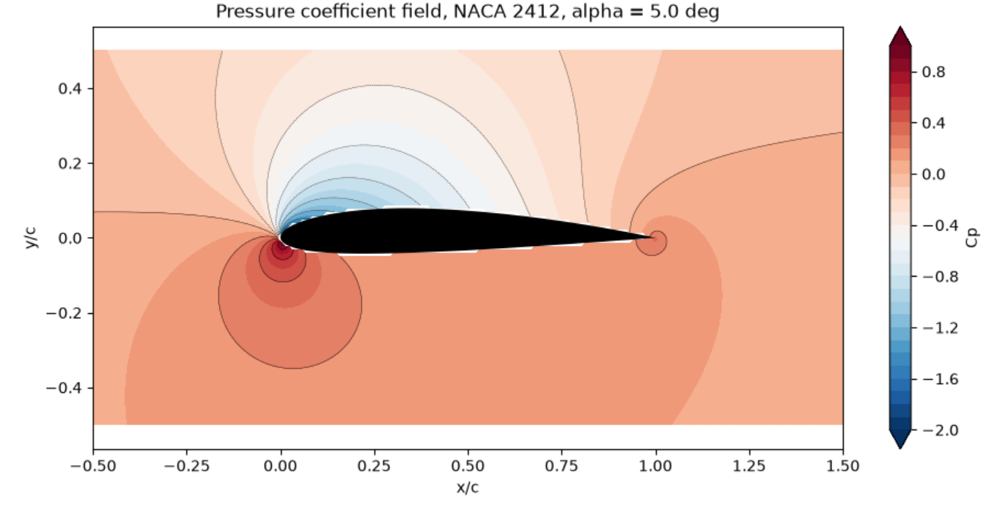

# Panel Method for NACA Airfoils

[](https://colab.research.google.com/github/Malik-Saif-Ullah/panel_method_for_naca_airfoils/blob/main/panel_method_for_naca_airfoils.ipynb)

A custom numerical solver, written from scratch in Python, that simulates **inviscid, incompressible potential flow over arbitrary 2D airfoils** (NACA 4-digit series) using the **Hess-Smith panel method**.

Course project: **SYSE-822 Applied Aerodynamics, Project I**.

## Problem statement

Develop a custom numerical solver in Python or MATLAB to simulate inviscid, incompressible potential flow over arbitrary 2D airfoil geometries (such as the NACA 4-digit series) using the Panel Method. The original instructions are in [`problem_statement/`](problem_statement/problem_statement.pdf).

## Method in five steps

1. Replace the airfoil by N straight panels (cosine spacing, so more panels at the leading and trailing edges).
2. Put a source of unknown strength on every panel and one common vortex strength on all panels.
3. **Wall condition:** no flow through the surface at the midpoint of every panel (N equations).
4. **Kutta condition:** the flow leaves the sharp trailing edge smoothly (1 equation). This fixes the circulation, and therefore the lift.
5. Solve the (N+1) x (N+1) linear system. Then:
   * surface speed gives `Cp = 1 - (V / Vinf)^2`
   * pressure force `F = -Cp * n * dl` summed over panels gives CL and CD
   * the same panel formulas give the velocity anywhere in the flow field

## Repository structure

```
panel_method_for_naca_airfoils/
|-- panel_method_project.ipynb   main notebook (code, outputs and viva notes)
|-- problem_statement/           original project instructions
|-- results/                     result figures
|-- requirements.txt             Python packages needed
|-- README.md
|-- LICENSE
`-- .gitignore
```

## How to run

### Option A: in the browser, nothing to install

Click the **Open In Colab** badge at the top of this page, then choose **Runtime > Run all**.

### Option B: on your own computer

You need Python 3.8 or newer and Git.

```bash
# 1. get the code
git clone https://github.com/Malik-Saif-Ullah/panel_method_for_naca_airfoils.git
cd panel_method_for_naca_airfoils

# 2. (recommended) create a virtual environment
python -m venv venv
venv\Scripts\activate            # Windows
# source venv/bin/activate       # macOS or Linux

# 3. install the packages
pip install -r requirements.txt

# 4. open the notebook
jupyter notebook panel_method_project.ipynb
```

In Jupyter choose **Kernel > Restart & Run All**. Every graded output appears in its own cell.

### Option C: VS Code

Open the folder in VS Code, install the *Python* and *Jupyter* extensions, open `panel_method_project.ipynb`, select your Python interpreter and click **Run All**.

### Try your own airfoil

Edit only the second cell and run all cells again:

```python
CODE  = "2412"   # NACA 4-digit code: try 0012, 4412, 6409
ALPHA = 5.0      # angle of attack in degrees
N     = 160      # number of panels
```

## Results

Reference run: NACA 2412, alpha = 5 degrees, N = 160 panels.

| Quantity | Result |
|---|---|
| CL from pressure integration | 0.857 |
| CL from Kutta-Joukowski (independent check) | 0.857 |
| CD from pressure integration | -0.0003 (ideal value is 0) |
| Lift slope | 6.86 per rad (thin airfoil theory: 6.28) |
| Zero-lift angle | -2.13 deg (thin airfoil theory: -2.08 deg) |
| Suction peak | Cp = -1.91 at x/c = 0.010 |

Figures (saved from the notebook into [`results/`](results/)):

| Pressure coefficient | Lift curve |
|---|---|
|  |  |

| Drag analysis | Velocity field | Pressure field |
|---|---|---|
|  |  |  |

## Validation

* CL from pressure integration agrees with CL from the Kutta-Joukowski theorem (circulation).
* The lift slope and zero-lift angle agree with thin airfoil theory. The slope is slightly higher because thickness adds lift.
* CD goes to zero as the number of panels increases (d'Alembert's paradox).

## Limitations

* Inviscid flow: no skin friction, no boundary layer, no stall (CL keeps rising with alpha).
* Incompressible flow: valid only at low Mach number.
* The viscous drag number in the notebook is a rough empirical estimate for perspective, not part of the panel method.

## References

* J. Katz and A. Plotkin, *Low-Speed Aerodynamics*, Cambridge University Press.
* J. D. Anderson, *Fundamentals of Aerodynamics*, McGraw-Hill.
* I. H. Abbott and A. E. von Doenhoff, *Theory of Wing Sections*, Dover.

## Author

Malik Saif Ullah

## License

Released under the MIT License, see [LICENSE](LICENSE).
